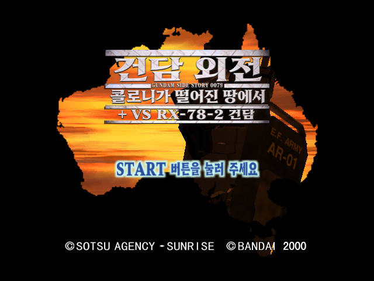

# [DC] 건담 외전 — 콜로니가 떨어진 땅에서 · 한국어 패치 v0.81

**한글화: 기타 깎는 노인**

드림캐스트 **Gundam Side Story 0079 - Rise from the Ashes - Special Edition (Japan)**용 비공식 한국어 패치입니다. Windows용 EXE 하나로 원본 일본판 CHD에서 한글 CHD를 만듭니다. 게임 안의 코드가 영상·음성 자막을 직접 표시합니다.

[**v0.81 EXE 패처 다운로드**](https://github.com/OldManCraveGuitars-bit/DC-Gundam-Side-Story-0079-Rise-from-the-Ashes-Kr/releases/download/v0.81/DC-Gundam-Side-Story-0079-Kr-Patcher-v0.81.exe) · [안내·도구가 포함된 ZIP](https://github.com/OldManCraveGuitars-bit/DC-Gundam-Side-Story-0079-Rise-from-the-Ashes-Kr/releases/download/v0.81/DC-Gundam-Side-Story-0079-Kr-v0.81.zip) · [릴리스](https://github.com/OldManCraveGuitars-bit/DC-Gundam-Side-Story-0079-Rise-from-the-Ashes-Kr/releases/tag/v0.81)

## v0.81 변경 사항

- START 안내와 모든 메인 선택문을 **함렡 Black**으로 다시 만들었습니다. 실제 글자 높이는 원본과 같은 **START 22px / 메뉴 18px**입니다.
- 점멸층의 RGB까지 어두워져 빛 번짐이 묻히던 오류를 수정했습니다. 원본의 점멸 속도와 기본 글자 뒤에서 번지는 순서는 유지합니다.
- START 안내의 발광 영역을 맞춰 가장자리 번짐이 잘리지 않게 했습니다.
- v0.81도 **패치 전 일본판 원본 CHD에 적용**합니다. 기존 v0.8 한글 CHD를 입력하면 원본을 선택하도록 안내합니다.

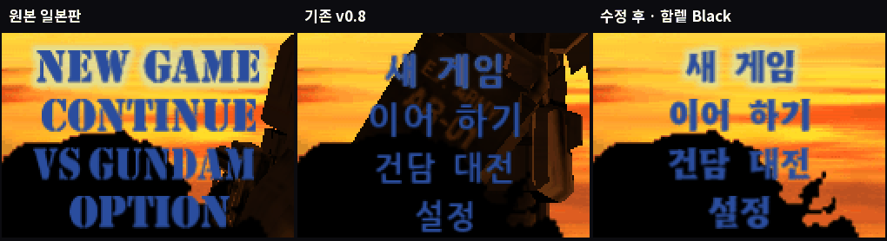

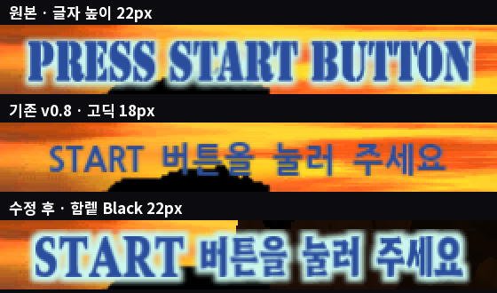

## 적용 방법

1. EXE 패처를 실행하고 **패치 전 일본판 Special Edition 원본 CHD**를 선택합니다.
2. 한글 CHD를 저장할 새 파일 이름을 지정합니다. 출력 드라이브에 **3GB 이상** 여유 공간이 필요합니다.
3. **한국어 패치 적용**을 누르고 완료될 때까지 기다립니다. 원본 크기·SHA-256, 적용 데이터, 완성된 CHD를 자동 검사합니다.
4. 완성된 `Gundam-Side-Story-0079-Korean-v0.81.chd`를 실행합니다. 자막은 게임에 내장돼 있으며 별도 실행 프로그램이 필요하지 않습니다.

원본은 보존하며 기존 출력 파일에도 덮어쓰지 않습니다. 다른 판본이나 재압축된 CHD는 해시가 다르므로 지원 대상 원본을 확인해 주세요. 패처는 Windows x64용이며 Python 설치가 필요하지 않습니다. 생성 결과 옆에 적용 결과 JSON 기록이 남습니다.

## 패치 내용

- **타이틀·메뉴**: 원본 디자인에 맞춘 한글 로고, 하단 문구 잘림과 오른쪽 잔선 수정, 메뉴 기본 글자와 반짝임 글리프의 위치 통일.
- **UI·버튼 안내**: 타이틀·메뉴·경고문·결과 화면·크레딧 등 이미지 89종에 수정 자료를 반영. 버튼 안내의 글자와 연결선 간격 조정, YES/NO 글자·선택 상자·경고문 중앙 정렬.
- **대사 자막**: 한국어 대사 1,584구간 수록. 16px 흰 글씨·검은 외곽선·반각 공백 적용, 받침과 문장부호 잘림 보완.
- **영상 자막**: 원본 영상은 유지하고 실제 재생 시계에 맞춰 게임 안에서 출력. 영상 창 자막은 32px, 브리핑 지도와 출격 연출 자막은 56px 아래로 이동.
- **문장 검수**: 띄어쓰기·조사·문법·누락 인명·결과 화면 용어 교정.
- **한글화 표기**: 엔딩 마지막 로고에 “한글화: 기타 깎는 노인” 추가.

작은 UI는 원본 표시 영역에 따라 16px 또는 12px를 사용합니다. 이미지는 글자 부분을 수정하며 검은 사각판으로 덮지 않습니다. 출격 연출 시작 6초는 임무 제목 여백을 확보하고 전투 중 자막은 HUD 여백을 유지합니다.

## 스크린샷

### 타이틀 메뉴

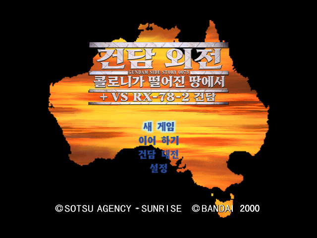

### 저장 확인창 — YES/NO 정렬

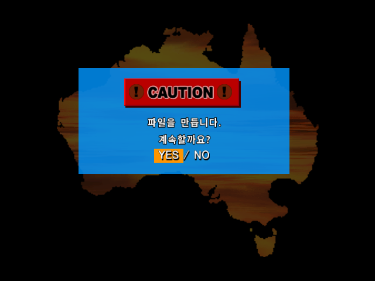

### B.I.C. 시스템 확인창 — 창 중앙에 맞춘 글자와 선택 상자

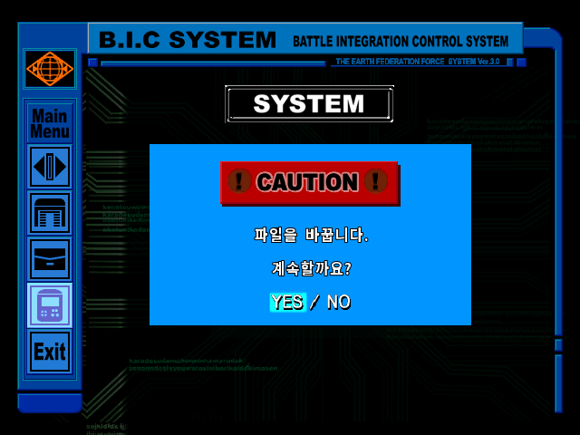

### 브리핑 지도 — 하단 자막

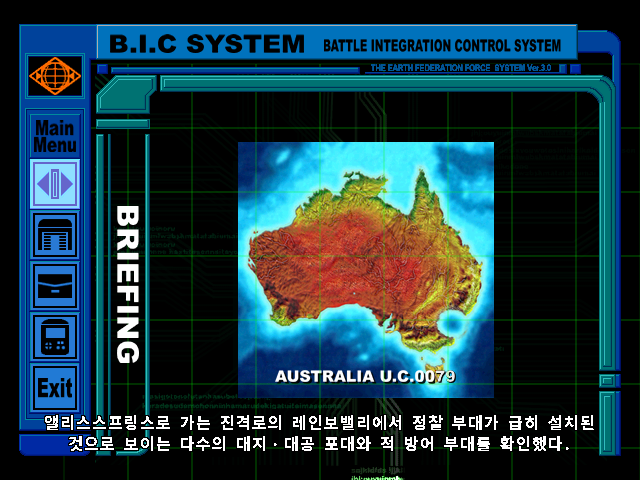

### 통신 영상 — 하단 자막

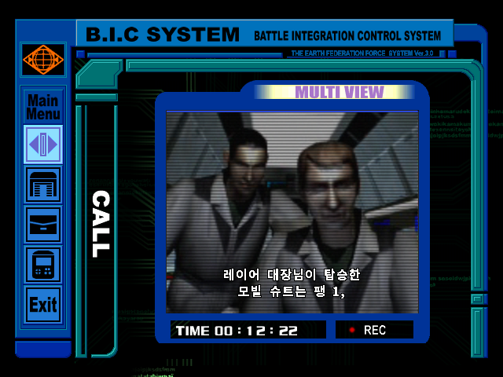

### 출격 연출 — 하단 자막

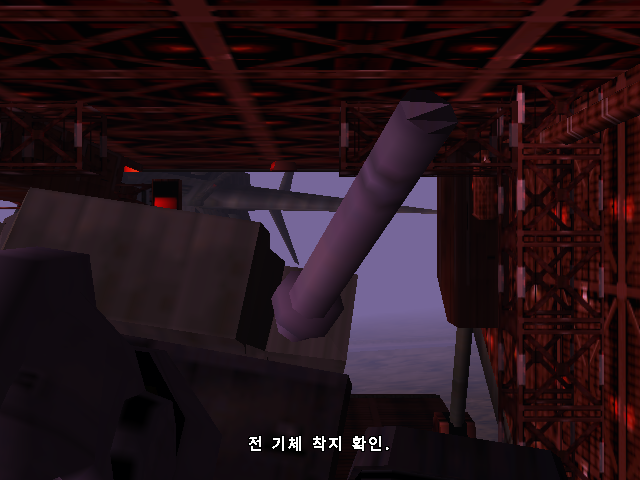

### 버튼 설정

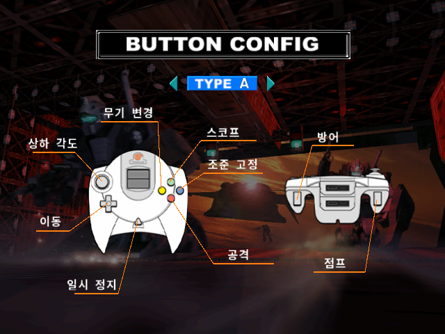

### 엔딩 한글화 표기

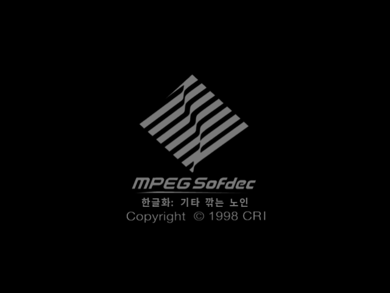

타이틀·메뉴는 v0.81 데이터의 새 부팅 캡처입니다. 나머지 화면은 해당 화면 데이터가 v0.81과 동일한 이전 실행 검증 사진입니다.

## SHA-256

| 파일 | 크기(bytes) | SHA-256 |
|---|---:|---|
| 일본판 원본 CHD | 513,023,163 | `6d8ea31835863ecc1095d1d09903e4235c4ceb8d39d5ed093eb2981e8a517fe7` |
| 패치 결과 CHD | 506,635,247 | `1a34f44e0366d6a79e6dc8bd5835650fa3078b025169d47f54ad0136f45ffdff` |
| DC-Gundam-Side-Story-0079-Kr-Patcher-v0.81.exe | 13,587,637 | `a91b3dd19a52566ba6d75a5292a187c82712791ae00a26b25abd2b665b57017f` |
| DC-Gundam-Side-Story-0079-Kr-v0.81.zip | 15,191,209 | `95e37b3b547da1cfd65fe29573078bf6324c1b1158977198e8338c6f74c1aee5` |


[SHA256SUMS.txt](SHA256SUMS.txt)와 [기계 판독용 해시](data/release-hashes.json)에 배포 파일 해시를 기록했습니다. EXE에는 패치 데이터와 CHD 처리 도구가 내장돼 있습니다. ZIP은 같은 EXE, 사용법, 재빌드용 차이 데이터·도구 및 라이선스를 담습니다. 원본·완성 CHD 및 BIOS는 포함하지 않습니다.

## 검증 범위와 남은 작업

- 원본 CHD에서 EXE 패처로 결과를 재생성해 기준 한글 CHD와 SHA-256 일치를 확인했습니다.
- 잘못된 원본, 이미 패치된 파일, 기존 출력 파일, 원본에 덮어쓰는 요청을 거부하도록 검사했습니다.
- 원본 대비 **613개 파일·7,158개 텍스처·3개 트랙**의 구조를 비교했습니다. 파일 위치·이름을 유지하고 선언한 수정분 밖의 데이터 변경이 없음을 확인했습니다.
- 원본 영상 **30개**와 음성 **400개**는 바이트 단위로 동일합니다. 완성 CHD의 raw/overall SHA-1 검사와 v0.81 데이터의 새 GDI 부팅·메뉴 점멸 출력을 확인했습니다. 내장 자막 코드는 v0.8과 동일합니다.
- 실기 실행은 테스트하지 않았습니다. 전체 임무 플레이와 전 음성 청취 검수는 남아 있습니다. 소음 때문에 원문이 불명확한 ST6ED/ST6ED1의 대사 4구간은 출력을 보류했습니다.

v0.81은 현재 작업분을 공개하는 시험판입니다. [검증 기록](docs/verification-v0.81.json), [메인 글리프·점멸 비교](docs/title-glyph-v0.81.json), [디스크 구조 검사](docs/disc-structure-v0.81.json), [내장 코드·글꼴 검사](docs/native-static-v0.81.json)를 함께 제공합니다.

## 패처 소스

`tools/release_patcher.py`가 적용기 소스입니다. ZIP의 `payload` 폴더를 저장소 루트에 놓고 Python 3.13에서 다음과 같이 빌드할 수 있습니다.

```powershell
python -m pip install -r requirements-build.txt
python -m PyInstaller --noconfirm tools/GundamKRPatcher.spec
```

MAME chdman의 정확한 버전 소스와 포함 라이선스는 [사용 도구 안내](THIRD_PARTY_NOTICES.md)에 기록했습니다. 게임 화면·캐릭터·원작 자료의 권리는 해당 권리자에게 있습니다.
